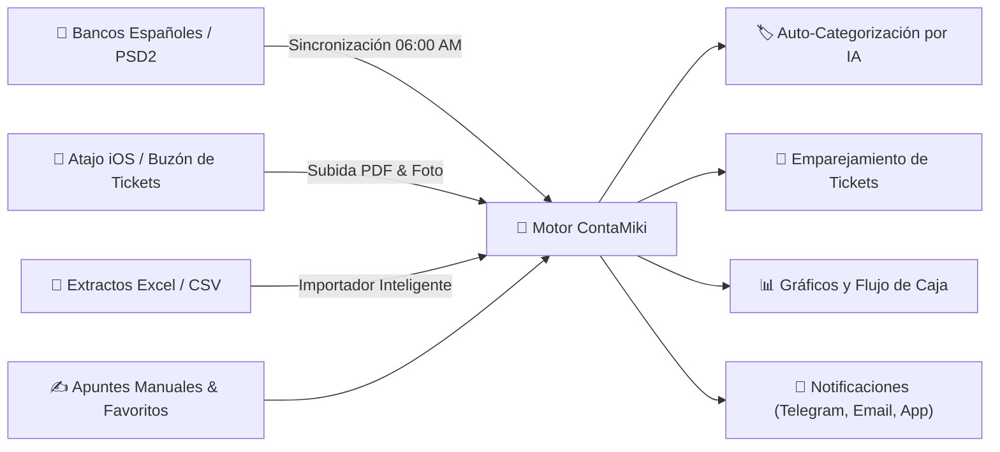

# ContaMiki 📊

<div align="center">
  

  <h3>Tu centro de mando financiero personal y familiar: potente, 100% privado y auto-alojado.</h3>

  <p>
    <strong>ContaMiki</strong> es una plataforma financiera moderna y completa diseñada para recuperar el control total de tu dinero. Olvídate de hojas de cálculo tediosas, suscripciones mensuales abusivas o apps comerciales que monetizan tus datos. Con ContaMiki dispones de <strong>Open Banking oficial europeo (PSD2)</strong>, <strong>categorización automática</strong>, <strong>buzón inteligente de facturas y tickets</strong>, <strong>importador masivo</strong> y <strong>análisis visual en tiempo real</strong>, todo corriendo bajo tu propio techo.
  </p>

  <p>
    <a href="#-características-y-operativa-completa"></a>
    <a href="#-despliegue-con-docker-en-2-minutos"></a>
    <a href="#-sincronización-bancaria-open-banking-psd2"></a>
    <a href="#-licencia"></a>
  </p>
</div>

---

## ✨ ¿Por qué ContaMiki?

| Característica | Aplicaciones bancarias típicas | Hojas de cálculo tradicionales | ContaMiki 📊 |
| :--- | :---: | :---: | :---: |
| **Privacidad de tus datos** | ❌ En servidores de terceros | ✅ Local | ✅ **100% tuyo (Self-Hosted en Docker)** |
| **Sincronización bancaria** | ⚠️ Solo su propio banco | ❌ Manual | ✅ **Automática multientidad (PSD2)** |
| **Buzón y archivo de tickets** | ❌ Rara vez disponible | ❌ Complejo de enlazar | ✅ **Adjunto PDF/Foto con visor nativo** |
| **Multi-Contabilidad (Hogar, Negocio...)** | ❌ No disponible | ⚠️ Archivos separados | ✅ **Cambio de contabilidad con un solo clic** |
| **Colaboración familiar** | ❌ Un solo usuario | ⚠️ Conflictos de edición | ✅ **Multi-usuario con roles y 2FA** |
| **Coste recurrente** | ❌ Suscripciones mensuales | ✅ Gratuito | ✅ **Gratis, libre y sin cuotas** |

---

## 🎯 Operativa y Funcionalidades en Detalle



### 1. 🏛️ Estructura Financiera Profesional: Cuentas, Familias y Categorías
ContaMiki no se limita a anotar gastos sueltos: te ofrece un modelo contable de tres niveles intuitivo y flexible:
- **Cuentas Bancarias y Monederos:**  
  Configura todas tus cuentas corrientes, cuentas de ahorro remuneradas, efectivo en cartera, depósitos o tarjetas. Cada cuenta cuenta con su divisa, icono personalizado y saldo consolidado en tiempo real.
- **Familias (Nivel Macro):**  
  Grandes bloques presupuestarios para entender tu estructura de costes de un vistazo (ej. *Hogar*, *Alimentación*, *Transporte*, *Ocio & Viajes*, *Salud*, *Nóminas*, *Inversiones*).
- **Categorías (Nivel Quirúrgico):**  
  Dentro de cada familia, define categorías precisas (ej. dentro de *Alimentación*: *Mercadona*, *Carnicería*, *Restaurantes*, *Cafeterías*). Así sabrás con exactitud matemática a dónde va cada euro.

---

### 2. ✍️ Entrada de Apuntes Manual y Accesos Rápidos
Registrar un movimiento en el día a día es una experiencia inmediata y agradable:
- **Entrada Ultra-Rápida:** Formularios optimizados para móvil y ordenador con selector rápido de fecha, cuenta de cargo/abono, importe e imputación de categoría.
- **⭐ Movimientos Favoritos:**  
  ¿Compras el pan a diario o tomas café en el mismo bar? Guarda tus gastos más repetitivos como favoritos para generarlos con **un solo toque** en pantalla sin volver a rellenar nada.
- **🔁 Movimientos Periódicos y Recurrentes:**  
  Automatiza tus cuotas fijas: alquiler, hipoteca, nóminas, suscripciones (Netflix, Spotify), recibos de luz, seguros o cuotas de comunidad. Define la periodicidad (mensual, quincenal, trimestral, anual) y ContaMiki los mantendrá al día.
- **Transferencias entre cuentas:**  
  Registra traspasos de fondos entre tus propias cuentas con trazabilidad perfecta de origen y destino.
- **Conciliación y Validación:**  
  Los movimientos cuentan con un indicador de estado (*«Pendiente de revisar»* vs *«Validado con check verde»*). Así siempre sabrás qué movimientos has comprobado y cuáles acaban de entrar.

---

### 3. 📎 Buzón de Tickets Inteligente y Visor Nativo de Facturas
Nunca más perderás una garantía ni un justificante de compra:
- **Adjunta cualquier comprobante:**  
  Soporta facturas en **PDF**, fotos de tickets en **JPG** o **PNG**.
- **Visor Interactivo Integrado:**  
  Abre cualquier transacción y previsualiza el PDF o la foto directamente en un visor nativo integrado en la aplicación, con opciones de pantalla completa, zoom y descarga.
- **📥 Buzón de Tickets Inbox (`tickets_inbox`):**  
  Deja tus PDFs o fotos en la carpeta compartida de red de tu NAS o envíalos desde tu teléfono móvil. En el barrido diario, ContaMiki analiza el importe y la fecha del documento y lo **empareja automáticamente con el movimiento bancario correspondiente**, eliminándolo del buzón una vez conciliado.

---

### 4. 📲 Integración con iPhone, iPad y Atajos de Apple (iOS)
Envía tickets a tu buzón en segundos sin abrir la web:
- **Atajo oficial con Apple Intelligence:**  
  Configura en menos de 1 minuto un atajo que aparece en el menú nativo **Compartir** de iOS.
- **Un toque desde cualquier app:**  
  Estés viendo un recibo en Mail, una foto en la galería o un PDF en WhatsApp, pulsas *Compartir* ➔ *«Subir a ContaMiki»* y viajará directo a tu buzón para ser conciliado.

---

### 5. 🧠 Motor de Auto-Categorización Inteligente
- Cuando sincronizas con el banco o importas extractos, ContaMiki analiza los nombres de comercios y conceptos bancarios.
- Aprende de tus categorizaciones históricas: si siempre asignas *"MERCADONA"* a *Alimentación ➔ Supermercado*, el sistema le asignará esa categoría de forma automática en cuanto detecte el cargo.

---

### 6. 📑 Importador Inteligente de Extractos (Excel y CSV)
¿Tienes meses de histórico o extractos de tarjetas de crédito con liquidación diferida?
- Arrastra directamente el archivo Excel (`.xlsx`, `.xls`) o `.csv` descargado de la banca online.
- El asistente inteligente detecta las columnas, formatea los importes y signos, y te muestra una vista previa interactiva antes de confirmar la importación.

---

### 7. 🏦 Sincronización Bancaria Automática (Open Banking PSD2)
- **Conexión Directa y Homologada:**  
  Conexión nativa con la infraestructura europea de **Enable Banking** bajo la estricta normativa bancaria **PSD2**.
- **Bancos Españoles y Europeos:**  
  Compatible con *CaixaBank, Banco Santander, BBVA, Bankinter, Banco Sabadell, ING, Openbank, Abanca, Kutxabank, Unicaja* y más de 100 entidades.
- **Sincronización Matutina Silenciosa:**  
  El servidor ejecuta un barrido automático programable (por defecto a las **06:00 AM**) para que cuando te despiertes a las 07:00 AM tengas tus saldos actualizados y las facturas emparejadas.
- **Protección Anti-Duplicados:**  
  Algoritmo estricto de triple coincidencia (cuenta, fecha e importe exacto) que garantiza que jamás se duplique un apunte aunque solapen las fechas de consulta.
- **Sincronización Manual Selectiva:**  
  Posibilidad de sincronizar todas las cuentas vinculadas a la vez o abrir el selector interactivo para centrarse únicamente en una o dos cuentas específicas, además de contar con un botón de sincronización directa en cada cuenta individual.

---

### 8. 🔔 Notificaciones Multicanal (Telegram, Cartero y App)
Elige cómo quieres recibir tu resumen financiero matutino:
- **🤖 Bot de Telegram:** Recibe un mensaje diario formateado con el número de movimientos nuevos descargados, facturas emparejadas y tickets pendientes.
  > **¿Cómo configurarlo en 2 minutos?**
  > 1. Abre Telegram y escribe a [@BotFather](https://t.me/BotFather) el comando `/newbot`. Te dará tu **Bot Token** (ej. `8611126291:AA...`).
  > 2. Escribe a [@userinfobot](https://t.me/userinfobot) y pulsa *Iniciar* para obtener tu **Chat ID** (ej. `651388683`).
  > 3. ¡Importante! Abre el chat de tu nuevo bot y pulsa **«Iniciar»** (`/start`). Pega ambos datos en ContaMiki y pulsa *Probar Telegram*.
- **✉️ Cartero Email:** Envío automático del resumen matutino a tu correo electrónico personal.
- **🔔 Avisos In-App:** Notificaciones en la campana dentro de la propia plataforma.

---

### 9. 🏠 Multi-Contabilidad y Colaboración Multi-Usuario Segura
- **Separación total de entornos:**  
  Crea varias contabilidades independientes (ej. *CASA*, *NEGOCIO*, *SEGUNDA RESIDENCIA*, *AHORROS*). Cambia entre ellas al instante sin mezclar presupuestos ni movimientos.
- **Colaboración Familiar:**  
  Invita a tu pareja, familiares o socios. Puedes asignar permisos de edición completa o acceso de solo lectura sobre contabilidades específicas.
- **Máxima Seguridad:**  
  Autenticación con tokens JWT, contraseñas hasheadas con bcrypt y soporte nativo de **Doble Factor de Autenticación (2FA / TOTP)** compatible con Google Authenticator, Authy o 1Password.
- **Copias de Seguridad Automáticas Diarias:**  
  Sistema de backups rotativos automáticos locales por cada contabilidad para que nunca pierdas un solo dato.

---

## 🐳 Despliegue con Docker en 2 minutos

La forma recomendada de desplegar ContaMiki en un NAS (Synology, QNAP, Unraid), servidor doméstico o VPS es mediante **Docker Compose**.

### 1. `docker-compose.yml`

```yaml
version: '3.8'

services:
  contamiki:
    container_name: contamiki
    image: ghcr.io/mikiaiapp/contamiki:latest  # o build: . si compilas el código fuente
    restart: unless-stopped
    ports:
      - "3000:3000"
    environment:
      - PORT=3000
      - NODE_ENV=production
      - JWT_SECRET=cambia_esta_clave_por_una_cadena_larga_y_aleatoria_123456
      - APP_URL=https://conta.tudominio.com  # URL pública o IP con protocolo
    volumes:
      - /ruta/a/tu/almacenamiento/data:/app/data
```

### 2. Levantar el servicio

```bash
docker compose up -d
```

Accede desde tu navegador a `http://tu-ip:3000` (o a través de tu proxy inverso con HTTPS como Nginx Proxy Manager, Cloudflare Tunnels o Traefik).

---

## 🔑 Configuración de Open Banking (Enable Banking)

Todo el proceso de credenciales se gestiona **directamente desde la interfaz web de ContaMiki** (en **Ajustes ➔ Bancos & Tickets ➔ Ajustar Credenciales**):

1. **Alta gratuita:** Regístrate como desarrollador en [enablebanking.com](https://enablebanking.com) (el servicio es gratuito para uso personal y sustituye la antigua API de GoCardless).
2. **Crear aplicación:**
   - En el panel de Enable Banking ve a **API applications** ➔ **Add a new application**.
   - Entorno: **Production**.
   - Generar clave en el navegador: se descargará automáticamente tu archivo **`enablebanking.pem`**.
   - Allowed redirect URLs (puedes copiarlas desde el botón de la app):
     ```text
     https://tu-dominio.com/api/bank/callback
     https://tu-dominio.com/
     ```
3. **Activar en producción:**
   - En el panel de Enable Banking, selecciona tu banco en el cuadro desplegable y pulsa **Link** para autorizar tu primera cuenta personal (la app pasará de `Inactive` a `Active`).
4. **Guardar en ContaMiki:**
   - Entra en ContaMiki en **Ajustes ➔ Bancos & Tickets ➔ Ajustar Credenciales**.
   - Pega tu **Application ID**, carga o pega tu clave **`enablebanking.pem`** y pulsa **Guardar y Verificar**.
   - Pulsa el botón negro **«Vincular Banco»**, autoriza tu entidad y asigna cada cuenta a tu contabilidad correspondiente.

---

## 📁 Estructura del Almacenamiento Persistente

Todos tus datos se almacenan de forma ordenada dentro del volumen `/app/data`:

```text
data/
├── users.json                 # Registro de usuarios y credenciales seguras
├── bank_config.json           # Configuración activa de Open Banking
├── bank_connections.json      # Conexiones bancarias autorizadas y mapeos
├── enablebanking.pem          # Clave RSA privada para Open Banking
├── tickets_inbox/             # Buzón temporal de facturas y tickets pendientes
│   └── factura_mercadona.pdf
└── users/
    └── usuario_email_com/
        ├── metadata.json      # Contabilidades y permisos del usuario
        ├── backups/           # Copias de seguridad automáticas diarias
        └── default_book_1/
            ├── config.json    # Cuentas, familias, categorías, favoritos y periódicos
            ├── transactions_2024.json
            ├── transactions_2025.json
            └── transactions_2026.json
```

---

## 💻 Desarrollo Local

Para ejecutar o contribuir al código fuente:

```bash
# 1. Clonar el repositorio
git clone https://github.com/mikiaiapp/contamiki.git
cd contamiki

# 2. Instalar dependencias
npm install

# 3. Iniciar entorno de desarrollo
npm run dev
```

---

## 📄 Licencia

Este proyecto está publicado bajo la licencia de código abierto [MIT](LICENSE). Siéntete libre de utilizarlo, modificarlo y compartirlo.
